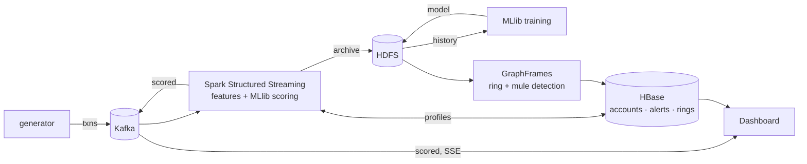

# SentriX

Real-time detection of fraudulent UPI-style transactions, plus batch analysis of the
transaction network to find fraud rings and mule accounts.

Transactions stream through **Kafka** into **Spark Structured Streaming**, which computes
per-account behavioural features and scores every transaction with a **Spark MLlib** model
trained on history stored in **HDFS**. Account profiles, features and flagged transactions
live in **HBase**. A **GraphFrames** batch job finds rings and mules, and a web dashboard
shows the live feed, alerts and detected rings. Everything runs on a 1 master + 2 worker
cluster (Docker Compose).



## Cluster

| Node | Runs |
|------|------|
| `master` | HDFS NameNode, Spark master, HBase master + ZooKeeper + Thrift, Kafka broker (KRaft) |
| `worker1`, `worker2` | HDFS DataNode, Spark worker, HBase RegionServer |
| `dashboard` | FastAPI web app (outside the cluster, talks to HBase and Kafka) |

Versions: Java 11, Hadoop 3.3.6, HBase 2.6.7, Spark 3.5.9, Kafka 3.9.2, GraphFrames 0.9.3.
All nodes use one image (`infra/Dockerfile`); `infra/entrypoint.sh` starts the daemons for
each node's role. The repo is mounted at `/app` on every node, so code changes need no rebuild.

## Run it

Needs Docker with about 8 GB of RAM free. The first build downloads about 1.6 GB.

```bash
make up        # build and start the cluster + dashboard
make status    # expect 2 DataNodes, 2 Spark workers, 2 RegionServers
make history   # 24h of labelled transactions -> HDFS
make train     # train the model, seed account profiles in HBase
```

Then, in two terminals:

```bash
make stream    # real-time scorer; restart it after `make train` to load the new model
```

```bash
make live      # live transactions -> Kafka
```

Open the dashboard at http://localhost:8000. Run the ring detection at any time, also
while the scorer runs (it analyses the newest 250,000 transactions of history plus archived live data):

```bash
make rings
```

Web UIs: HDFS http://localhost:9870, Spark http://localhost:8080 (running job: :4040),
HBase http://localhost:16010. All ports are bound to localhost only.
`make test` runs the unit tests; `make clean` deletes all data.

## Results

Measured on this setup (one laptop-class host, synthetic data, so expect real traffic to be harder):

| What | Result |
|------|--------|
| Model, held-out last 20% of history (35,765 txns, 942 fraud) | AUC-ROC 1.000, AUC-PR 0.992, precision 0.984, recall 0.943 |
| Live scoring | 2.4% of transactions flagged (injected fraud is ~2.7%) |
| Latency, transaction to scored output | p50 4.1 s, p95 6.5 s (2 s micro-batches) |
| Ring detection | all 18 ring accounts in 4 rings, precision 1.00 |
| Mule detection | all 3 mules, precision 1.00 |
| Training / ring job runtime | ~55 s / ~60 s |

## How it works

**Data** (`sentrix/gen.py`). A fixed world of 2,000 users and 200 merchants. Each user has a
phone, a typical amount, a few friends and favourite shops. On top of normal payments the
generator injects:

| Pattern | What happens |
|---------|--------------|
| takeover | burst of 4-8 payments to strangers from a new device, 3-10x the usual amount |
| spike | one payment 15-40x the usual amount to a stranger |
| ring | 3-6 fixed accounts pass Rs 20k-50k around a cycle, a small cut at each hop |
| mule | 10-25 scam victims pay a mule, which forwards ~90% to a cash-out account |

History mode writes labelled JSON lines; live mode sends unlabelled transactions to Kafka
in real time. Both use the same accounts and the same rate (2 txns/s).

**Features** (`sentrix/features.py`). For each transaction, from the payer's earlier activity:
`amount`, `cnt_10m` and `sum_10m` (payments in the last 10 minutes), `amt_ratio` (amount over
the payer's average), `new_payee`, `new_device`. One function computes them for training
(replayed over history per payer) and for the live scorer (profile kept in HBase), so the
model sees the same features in both.

**Model** (`jobs/train.py`). Random forest (50 trees) in a Spark ML pipeline, trained on the
first 80% of the history and tested on the last 20%. It is saved to HDFS, and each account's
final profile seeds HBase so live scoring starts with real history. Retraining leaves existing
profiles alone, because the live scorer keeps them current.

**Scoring** (`jobs/stream.py`). Structured Streaming reads `txns` from Kafka every 2 seconds.
The batch is partitioned by payer; executors load the payers' profiles from HBase, compute
features, and write the updated profiles back. Transactions with fraud probability >= 0.5
are flagged. Every scored transaction goes to Kafka `scored` (dashboard feed) and to HDFS
(input for the ring job); flagged ones go to the HBase `alerts` table.

**Rings and mules** (`jobs/rings.py`). Over the newest 250,000 transactions (about a day of
activity), accounts are vertices and each payer -> payee pair is one edge with its transfer
count and total. Rings are strongly connected components with 3+
accounts in the subgraph of repeated (2+) edges that moved at least Rs 50,000: money that
keeps coming back to where it started. Mules are accounts paid once each by 20+ different
payers that pass on 50-150% of what they receive. Results replace the HBase `rings` table,
and the job prints precision and recall against the generator's labels.

**HBase tables**

| Table | Row key | Columns |
|-------|---------|---------|
| `accounts` | VPA | `p:state` feature profile, `f:last` latest features |
| `alerts` | inverted timestamp + txn id (newest first) | `a:json` scored transaction |
| `rings` | cluster id | `r:json` members, edges, score |

## Layout

```
infra/       Dockerfile, entrypoint.sh, Hadoop/HBase/Spark/Kafka config
sentrix/     generator, feature definitions, HBase helpers
jobs/        Spark jobs: train.py, stream.py, rings.py
dashboard/   FastAPI app and the single-page UI
tests/       unit tests (features, generator, dashboard API, ring and mule rules on local Spark)
```

## Known limits

- A micro-batch replayed after a driver crash updates profiles twice (at-least-once).
- The scorer appends one small Parquet file per micro-batch to the archive; compact it if
  the demo runs for days.
- Ring and mule thresholds are tuned for the synthetic data, not real UPI traffic.
