<div align="center">

# SentriX

## Real-Time UPI Fraud Detection with Fraud-Ring Analysis

<br>

**Project Report**

submitted in partial fulfilment of the requirements of the course

**Big Data (CSBB 422)**

<br>

**Submitted to**

Dr. Himadri Singh

<br>

**Submitted by**

| Name | Roll No. |
|:---|:---:|
| Mithil Batra | 231210068 |
| Nandini | 231210076 |
| Nishant Porwal | 231210077 |
| Swayam Saini | 231210110 |

<br>

Department of Computer Science and Engineering

[Name of the Institute]

November 2026

</div>

<div style="page-break-after: always;"></div>

## Declaration

We declare that the project report titled *"SentriX: Real-Time UPI Fraud Detection with Fraud-Ring Analysis"*, submitted for the course Big Data (CSBB 422), is a record of work carried out by us. The system described here was designed, built and tested by the four of us. Where we have used ideas, data or figures from other sources, they have been cited in the References section.

| Name | Roll No. | Signature |
|:---|:---:|:---:|
| Mithil Batra | 231210068 | |
| Nandini | 231210076 | |
| Nishant Porwal | 231210077 | |
| Swayam Saini | 231210110 | |

Date: ____________

## Acknowledgement

We would like to thank Dr. Himadri Singh for teaching Big Data this semester and for giving us a project that made us actually run a cluster instead of only reading about one. The lectures on the Hadoop ecosystem shaped many of the design decisions in this report, in particular which kind of data belongs in HBase and which in HDFS.

We also thank the Department of Computer Science and Engineering for the lab facilities.

<div style="page-break-after: always;"></div>

## Abstract

The Unified Payments Interface (UPI) handled about 20.7 billion transactions in October 2025 alone, and the number of fraud cases has grown along with it. Most fraud checks look at one payment at a time. That catches a stolen phone sending money to strangers, but it misses organised fraud, where every single payment looks ordinary and only the pattern across many accounts gives it away.

SentriX is a big data pipeline that tries to cover both cases. Payments are streamed through Apache Kafka. Spark Structured Streaming computes six behavioural features for each payment from the payer's history, which is kept in Apache HBase, and a Random Forest model trained with Spark MLlib on historical data in HDFS gives each payment a fraud score. Separately, a GraphFrames batch job builds a graph of who paid whom and looks for two structures: fraud rings, where money circulates in a closed loop, and money mules, accounts that collect small payments from many victims and forward them on. A web dashboard shows the live feed, the alerts with the reasons they fired, and the detected rings.

The system runs on a cluster of one master and two worker nodes, either on a single machine with Docker Compose or on three physical PCs connected over a Docker Swarm overlay network. On a held-out test set taken from the last 20% of a simulated day, the model reached a precision of 0.984 and a recall of 0.943 (AUC-PR 0.992). In live operation a payment was scored about 4.1 seconds after it was created (median), and the graph job found all 18 ring accounts and all 3 mule accounts with no false positives. These numbers come from synthetic data, and we discuss why real traffic would be harder.

**Keywords:** UPI, fraud detection, Apache Kafka, Spark Structured Streaming, Spark MLlib, HBase, HDFS, GraphFrames, fraud rings, money mules

<div style="page-break-after: always;"></div>

## Table of Contents

1. [Introduction](#1-introduction)
2. [Background and Related Work](#2-background-and-related-work)
3. [Requirements and Project Setup](#3-requirements-and-project-setup)
4. [System Design](#4-system-design)
5. [Implementation](#5-implementation)
6. [Testing](#6-testing)
7. [Results and Discussion](#7-results-and-discussion)
8. [Challenges Faced](#8-challenges-faced)
9. [Limitations and Future Work](#9-limitations-and-future-work)
10. [Conclusion](#10-conclusion)
11. [References](#references)
12. [Appendix A: Running the Project](#appendix-a-running-the-project)
13. [Appendix B: Repository Layout](#appendix-b-repository-layout)
14. [Appendix C: Selected Configuration](#appendix-c-selected-configuration)

### List of Figures

| No. | Title | Section |
|:---:|:---|:---:|
| 1 | Overall architecture of SentriX | 4.1 |
| 2 | Cluster layout on a single machine | 4.2 |
| 3 | Deployment on three physical PCs | 4.3 |
| 4 | Life of one payment through the system | 4.4 |
| 5 | Training pipeline | 5.3 |
| 6 | Processing of one streaming micro-batch | 5.4 |
| 7 | Structure of a fraud ring | 5.5 |
| 8 | Structure of a money mule | 5.5 |
| 9 | The SentriX dashboard during a live run | 5.6 |
| 10 | A detected ring and a detected mule, as drawn by the dashboard | 7.4 |

### List of Tables

| No. | Title | Section |
|:---:|:---|:---:|
| 1 | Course requirements and how they are met | 3.1 |
| 2 | Software versions | 3.2 |
| 3 | Transaction record | 4.5 |
| 4 | HBase tables | 4.5 |
| 5 | Fraud patterns injected by the generator | 5.1 |
| 6 | Behavioural features | 5.2 |
| 7 | Dashboard endpoints | 5.6 |
| 8 | Automated tests | 6.1 |
| 9 | Model results on the held-out test set | 7.1 |
| 10 | Confusion matrix | 7.1 |
| 11 | Streaming and system measurements | 7.2 |
| 12 | Graph analysis results | 7.3 |
| 13 | Challenges and how we solved them | 8 |

<div style="page-break-after: always;"></div>

## 1. Introduction

### 1.1 Background

UPI has become the default way to pay in India, from tea stalls to rent. NPCI data for October 2025 shows 20.7 billion transactions worth about ₹27.28 lakh crore in a single month [1][2]. Fraud has grown with it. Figures presented in Parliament put UPI fraud in FY 2024-25 at 12.64 lakh cases and ₹981 crore [3], and ₹805 crore had already been lost in FY 2025-26 by November 2025 [4][5].

Two properties of UPI make fraud detection a big data problem. The first is speed. A UPI transfer settles in seconds, so a check that runs overnight is too late; the money has usually moved on by then. The second is volume. At hundreds of millions of payments a day, no single machine can keep every account's history in memory, train on months of data, and score each payment as it arrives.

### 1.2 Problem Statement

Most fraud falls into two groups that need different tools.

- **Individual fraud.** Someone steals a phone or a UPI PIN and quickly sends money to strangers, or a victim is tricked into sending one unusually large payment. These payments look strange compared with the account's own history, so they can be caught one at a time if the account's recent behaviour is known.
- **Organised fraud.** A group of accounts passes large sums around in a loop to hide where the money came from (a *fraud ring*), or one account collects payments from many scam victims and forwards most of it to a cash-out account (a *money mule*). Each payment on its own can look completely normal. Only the shape of the payment network gives it away.

The goal of this project was to build one system that handles both: score every payment in near real time using the payer's behaviour, and periodically analyse the whole payment graph for rings and mules, all on a distributed cluster.

### 1.3 Objectives

1. Stream payments through Apache Kafka in real time.
2. Compute behavioural features for each payment from the payer's recent activity.
3. Train a classifier with Spark MLlib on labelled history stored in HDFS, and evaluate it honestly on data from a later time period.
4. Score every live payment with Spark Structured Streaming within a few seconds.
5. Keep account profiles and flagged payments in HBase for fast lookup.
6. Find fraud rings and money mules with a GraphFrames batch job.
7. Show the live feed, the alerts and the detected rings on a web dashboard.
8. Run everything on a cluster of one master and two workers, both on one machine and on three separate PCs.

### 1.4 Scope

Real UPI transaction data is not available to students, for obvious privacy reasons, so we wrote a generator that simulates a population of accounts and injects known fraud patterns. This gives us labels for training and a ground truth for measuring the graph job. The trade-off is that our accuracy numbers describe how well the system finds the patterns we injected, not how it would do against real fraudsters. We return to this in Chapter 9.

### 1.5 Organisation of the Report

Chapter 2 covers the technologies we used and related work on fraud detection. Chapter 3 lists the requirements and the setup. Chapter 4 describes the design, and Chapter 5 the implementation of each component. Chapter 6 explains how we tested the system, and Chapter 7 presents the results. Chapter 8 discusses the problems we ran into, Chapter 9 the limitations and future work, and Chapter 10 concludes.

<div style="page-break-after: always;"></div>

## 2. Background and Related Work

### 2.1 Approaches to Fraud Detection

Bolton and Hand [6] group statistical fraud detection into supervised methods, which learn from past cases labelled as fraud or genuine, and unsupervised methods, which look for behaviour that departs from an account's normal pattern. In practice banks combine both with hand-written rules.

Two practical issues come up again and again in this literature. Fraud is rare, often well under 1% of transactions, so a model that never flags anything is still more than 99% "accurate". For this reason we report precision, recall and the area under the precision-recall curve rather than plain accuracy; Saito and Rehmsmeier [7] show that the PR curve is far more informative than the ROC curve on imbalanced data. The second issue is time. Fraud patterns change, so a model must be tested on data from after its training period, never on a random shuffle of the same period.

We chose a Random Forest [8] for the classifier. It handles features on very different scales (an amount in rupees next to a 0/1 flag) without normalisation, it copes with non-linear interactions such as "large amount *and* new payee", and Spark MLlib trains it in parallel.

Graph-based detection works at a different level. Instead of asking "is this payment unusual?", it asks "is this group of accounts unusual?". A set of accounts where money can flow from every member back to every other member is exactly a *strongly connected component* of the payment graph, a classic graph concept with a linear-time algorithm due to Tarjan [9]. GraphFrames provides a distributed version.

### 2.2 Technologies Used

**HDFS** (Hadoop Distributed File System) [10] stores large files split into blocks across DataNodes, with a NameNode keeping the metadata. It suits data that is written once and read in bulk. We use it for the training history, the trained model and the archive of scored payments.

**Apache HBase** is a distributed, column-oriented database modelled on Google's Bigtable [11]. Rows are sorted by key, and a single row can be read or written in milliseconds, which makes it a good fit for per-account profiles that must be fetched for every payment. HBase stores its own files on HDFS and uses ZooKeeper for coordination.

**Apache Kafka** [12] is a distributed log. Producers append messages to topics, and consumers read them in order at their own pace. Messages with the same key always go to the same partition, so their order is kept. We key payments by payer, so all of one account's payments stay in order.

**Apache Spark** [13] runs computations in parallel across a cluster. **Spark Structured Streaming** [14] treats a stream as a table that keeps growing and processes it in small *micro-batches*. **Spark MLlib** provides machine learning pipelines that train and run in parallel.

**GraphFrames** [15] adds graph algorithms on top of Spark DataFrames, including connected components, strongly connected components and motif finding.

**Docker and Docker Compose** package all of the above into one image and start the cluster with one command. **Docker Swarm** links several machines, and its *overlay network* lets containers on different PCs talk to each other as if they were on one network.

**FastAPI** is a Python web framework, which we use for the dashboard's backend. The frontend is plain HTML, CSS and JavaScript.

<div style="page-break-after: always;"></div>

## 3. Requirements and Project Setup

### 3.1 Course Requirements

The course set three conditions for the project setup. Table 1 shows how SentriX meets each one.

**Table 1: Course requirements and how they are met**

| Requirement | How SentriX meets it |
|:---|:---|
| One PC acting as the master node | The `master` node runs the HDFS NameNode, Spark master, HBase master with ZooKeeper and the Thrift server, and the Kafka broker. In the three-PC setup it runs on its own PC (`make lan-master`). |
| At least two PCs acting as worker nodes | `worker1` and `worker2` each run an HDFS DataNode, a Spark worker and an HBase RegionServer. In the three-PC setup each runs on its own PC (`make lan-worker N=1` and `N=2`). |
| A UI developed with any suitable framework or language | A web dashboard built with FastAPI (Python) and plain HTML, CSS and JavaScript, served from the master PC on port 8000. |

### 3.2 Software

All nodes use the same Docker image, so every PC runs exactly the same versions.

**Table 2: Software versions**

| Component | Version | Role |
|:---|:---|:---|
| Java (Eclipse Temurin JRE) | 11 | Runtime for Hadoop, HBase, Spark and Kafka |
| Python | 3.10 | Generator, Spark jobs, dashboard |
| Apache Hadoop (HDFS) | 3.3.6 | Distributed storage |
| Apache HBase | 2.6.7 | Key-value store for profiles, alerts, rings |
| Apache Spark | 3.5.9 | Streaming, MLlib, batch jobs |
| Apache Kafka (KRaft mode) | 3.9.2 | Message streams |
| GraphFrames | 0.9.3 | Graph algorithms on Spark |
| happybase | 1.3.0 | Python client for HBase (through Thrift) |
| kafka-python | 2.3.3 | Python client for Kafka |
| FastAPI, uvicorn | 0.162.0 | Dashboard backend |
| pytest | 9.2.0 | Automated tests |
| Docker Engine with Compose v2 | any recent | Packaging and cluster start-up |

### 3.3 Hardware

- **Single-machine mode:** one computer with Docker and about 10 GB of memory available to it. We measured a peak of 8.4 GB when the scorer, the live generator and the ring job were running at the same time (6.2 GB with only the scorer). Our test machine had 4 CPU cores and 16 GB of RAM.
- **Three-PC mode:** three computers on the same LAN, each running Docker Engine on Linux. Ports 2377/tcp, 7946/tcp+udp and 4789/udp must be open between them for Docker Swarm. Docker Desktop on macOS or Windows cannot act as a node, because it runs Docker inside a hidden virtual machine that the other PCs cannot reach directly.

<div style="page-break-after: always;"></div>

## 4. System Design

### 4.1 Architecture

Figure 1 shows the overall design. There are two paths through the system. The **real-time path** (left to right through Kafka and the streaming scorer) handles each payment within seconds. The **batch path** (training and the ring job) works on large amounts of stored data and runs on demand.

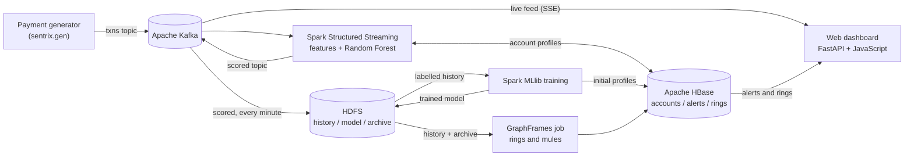

*Figure 1: Overall architecture of SentriX*

The main design rule was to put each kind of data where it is cheapest to use:

- Data that is **looked up by key, one row at a time** (an account's profile while scoring, the newest alerts, the detected rings) goes into **HBase**.
- Data that is **written once and read in bulk** (the day of training history, the trained model, the archive of scored payments) goes into **HDFS**.
- Data that is **in motion** (payments coming in, scored payments going out) lives in **Kafka**.

### 4.2 Cluster Layout

The cluster has one master and two workers, as Figure 2 shows. The dashboard runs as a fourth container next to the master; it is a client of the cluster, not part of it.

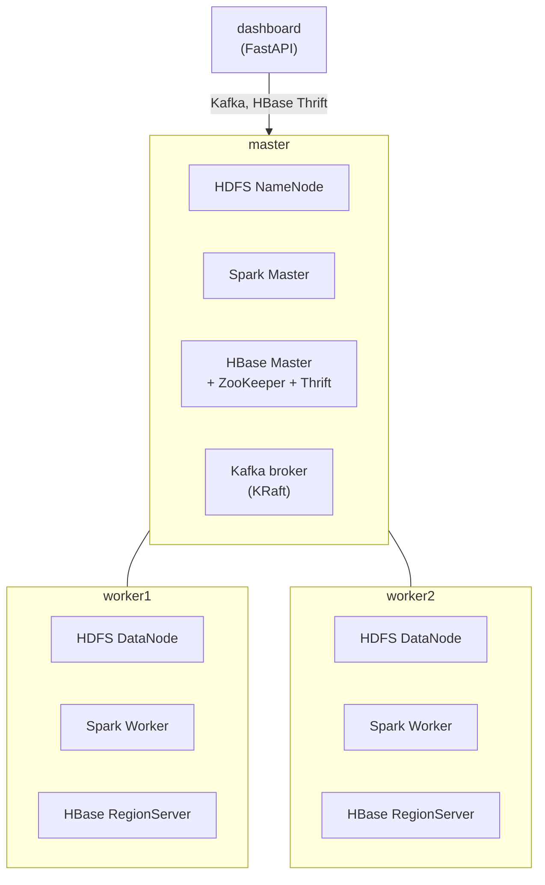

*Figure 2: Cluster layout on a single machine*

Some settings follow directly from this layout. HDFS keeps two copies of every block (`dfs.replication = 2`), one on each worker, so either worker can fail without losing data. Each Spark application may use at most two cores (`spark.cores.max = 2`), half the cluster, so the ring job can run while the streaming scorer is still running. Kafka's two topics have four partitions each, enough for both workers' executors to read in parallel.

### 4.3 Deployment on Three PCs

On a single machine, Docker Compose puts all four containers on one virtual network, and they find each other by name (`master`, `worker1`, `worker2`). Every configuration file in the project refers to these names; for example, HDFS is `hdfs://master:9000` and Kafka is `master:9092`.

For the three-PC setup we wanted to keep this property instead of rewriting the configuration for real IP addresses. We used a Docker Swarm *overlay network*: a virtual network that spans several machines. Each PC joins the swarm, and each node's container attaches to the shared network `sentrix-net`. The names then resolve across the PCs exactly as they do on one machine (Figure 3). The only new file is `docker-compose.lan.yml`, eight lines long, which swaps the default network for `sentrix-net`. No Hadoop, Spark, HBase or Kafka setting changes.

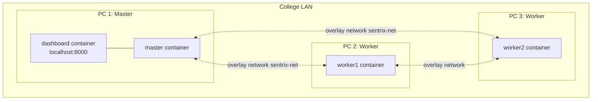

*Figure 3: Deployment on three physical PCs*

A side benefit is security. The cluster's internal ports (HDFS, Spark, Kafka, HBase) stay inside the overlay network and are not opened on the LAN. Only the swarm's own ports are exposed between the three PCs, and the web interfaces on the master stay bound to `localhost`. This matters on a shared college network, because HDFS's web port, for example, accepts writes without any login.

### 4.4 Life of One Payment

Figure 4 follows a single payment from the moment it is created until it appears on the dashboard.

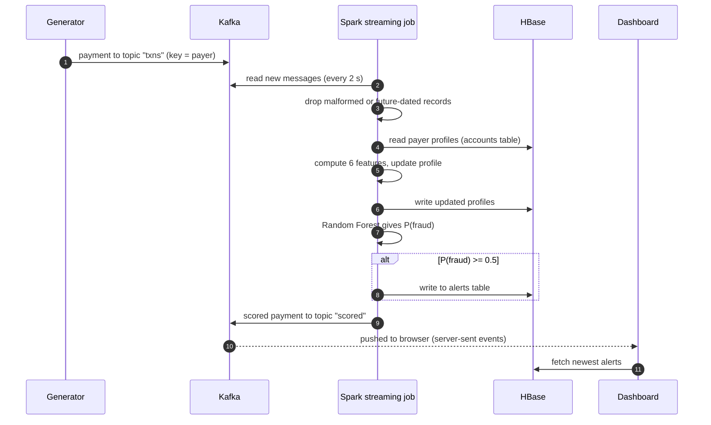

*Figure 4: Life of one payment through the system*

### 4.5 Data Model

**Table 3: Transaction record**

| Field | Type | Meaning |
|:---|:---|:---|
| `txn_id` | string | 16-character random hex identifier |
| `ts` | long | Time of the payment, milliseconds since 1970 |
| `payer` | string | Sender's virtual payment address, e.g. `u0325@upi` |
| `payee` | string | Receiver's address (a user `u…` or a merchant `m…`) |
| `amount` | double | Amount in rupees |
| `device` | string | Device identifier |
| `is_fraud`, `fraud_type` | int, string | Labels; only in the training history, never sent live |

**Table 4: HBase tables**

| Table | Row key | Column | Contents |
|:---|:---|:---|:---|
| `accounts` | account address | `p:state` | The account's profile (recent payments, known payees and devices, running average) |
| | | `f:last` | The features of its latest payment |
| `alerts` | inverted timestamp + `#` + txn id | `a:json` | A flagged payment with its features and score |
| `rings` | cluster id | `r:json` | Members, edges and total amount of a ring or mule cluster |

The alerts row key needs a word of explanation. HBase returns rows sorted by key, but the dashboard wants the newest alerts first. We therefore store `10^13 − ts`, padded to 13 digits, at the start of the key. A newer payment has a larger timestamp and so a smaller key, which puts it first in a normal scan. This avoids a sort on every request.

HDFS holds `/sentrix/history.jsonl` (the labelled training history), `/sentrix/model` (the trained pipeline), `/sentrix/archive` (scored payments as Parquet files) and the streaming checkpoints. Kafka has two topics, `txns` for incoming payments and `scored` for scored payments.

<div style="page-break-after: always;"></div>

## 5. Implementation

The code is small on purpose: about 570 lines of Python for the generator, the three Spark jobs and the dashboard backend, plus about 240 lines of HTML and JavaScript for the dashboard page.

### 5.1 Synthetic Data Generator

`sentrix/gen.py` builds a fixed "world" of 2,000 users and 200 merchants. Each user gets a phone (device id), a typical payment amount drawn from a log-normal distribution with a median of about ₹500, three to six friends and three to eight favourite shops. A normal payment goes to a shop 70% of the time, to a friend 25% of the time and to a stranger 5% of the time, from the user's usual phone 99% of the time.

On top of normal traffic the generator injects four fraud patterns (Table 5). The ring members, mules and cash-out accounts are fixed in advance, so the graph job's output can be checked against them.

**Table 5: Fraud patterns injected by the generator**

| Pattern | What happens | Chance per normal payment |
|:---|:---|:---:|
| Account takeover | A burst of 4 to 8 payments to strangers from a new device, each 3 to 10 times the usual amount, 15 to 60 seconds apart | 0.3% |
| Amount spike | One payment 15 to 40 times the usual amount, to a stranger | 0.5% |
| Fraud ring | One of four fixed groups of 3, 4, 5 or 6 accounts passes ₹20,000 to ₹50,000 around the loop 2 to 4 times, keeping a small cut at each hop | 0.02% |
| Money mule | 10 to 25 victims each pay one of three mules ₹2,000 to ₹15,000; the mule forwards about 90% to a cash-out account in 2 or 3 transfers | 0.01% |

The generator has two modes. `history` writes 24 hours of labelled payments to HDFS (about 179,000 records, a little under 3% of them fraud). `live` sends new payments to Kafka in real time at the same rate of two per second, with the labels removed. The same rate matters, because features such as "payments in the last 10 minutes" depend on how often accounts pay.

### 5.2 Feature Engineering

For each payment we compute six features from the payer's earlier activity (Table 6).

**Table 6: Behavioural features**

| Feature | What it measures | Mainly catches |
|:---|:---|:---|
| `amount` | The payment amount | Spikes |
| `cnt_10m` | Number of payments by this payer in the previous 10 minutes | Takeover bursts |
| `sum_10m` | Total sent by this payer in the previous 10 minutes | Accounts being drained |
| `amt_ratio` | Amount divided by the payer's average amount so far | Spikes, mule cash-outs |
| `new_payee` | 1 if the payer has not paid this payee before | Takeovers, scams |
| `new_device` | 1 if the payer has not used this device before | Takeovers |

The most important decision in this part of the project was to compute these features with **one Python function used for both training and live scoring**. A very common reason why a model works offline but fails in production is *train/serve skew*: the features are computed one way in the training code (often in SQL over the whole history) and another way in the live system, and small differences in the two implementations mean the model is scored on numbers it never learned from. In SentriX, `step(state, txn)` in `sentrix/features.py` takes an account's profile and a payment, returns the features, and updates the profile:

```python
def step(state, txn):
    """Features of `txn` from the payer's earlier activity, then fold `txn` into `state`."""
    ts, amount = txn["ts"], txn["amount"]
    recent = [r for r in state["recent"] if ts - r[0] <= WINDOW_MS]
    avg = state["amt_sum"] / state["amt_cnt"] if state["amt_cnt"] else amount
    features = {
        "amount": amount,
        "cnt_10m": float(len(recent)),
        "sum_10m": float(sum(a for _, a in recent)),
        "amt_ratio": amount / avg if avg else 1.0,
        "new_payee": float(txn["payee"] not in state["payees"]),
        "new_device": float(txn["device"] not in state["devices"]),
    }
    ...  # append to recent, update known payees/devices and the running average
    return features
```

During training, each payer's history is replayed through `step` in time order. During live scoring, the profile is loaded from HBase, passed through the same `step`, and written back. The profile is a small JSON document. To keep it from growing forever, it remembers only the 200 most recently used payees and devices; one that has not been used for longer counts as new again.

### 5.3 Model Training

`jobs/train.py` runs as a Spark job (Figure 5).

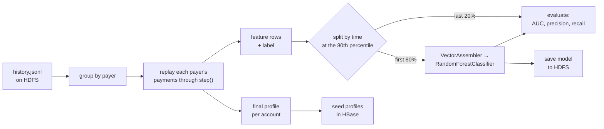

*Figure 5: Training pipeline*

The history is grouped by payer, so each worker replays whole accounts and the replay itself runs in parallel. The resulting rows are split **by time**: everything before the 80th percentile of timestamps is used for training, and the rest is used for testing. A random split would let the model see payments from 11 pm while being tested on payments from 10 pm, which is not how it would be used.

The model is a Spark ML pipeline of a `VectorAssembler`, which packs the six features into one vector, followed by a `RandomForestClassifier` with 50 trees and a maximum depth of 8. After evaluation the pipeline is saved to HDFS, and each account's final profile is written to HBase. That way, live scoring starts with a full day of history for every account instead of treating everyone as brand new. If the model is retrained later, profiles that already exist are left alone, because the live scorer has been keeping them up to date.

### 5.4 Real-Time Scoring

`jobs/stream.py` is the core of the system. It reads the `txns` topic with Spark Structured Streaming and processes a micro-batch every two seconds (Figure 6).

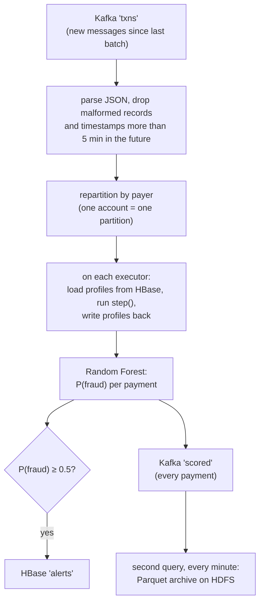

*Figure 6: Processing of one streaming micro-batch*

Some details here took more thought than the diagram suggests.

- **Input validation.** Messages that do not parse, or that have a missing field or a non-positive amount, are dropped. So are payments dated more than five minutes in the future. A future timestamp would stay inside the 10-minute window forever and inflate that account's features.
- **Work on the executors, not the driver.** The batch is repartitioned by payer, so all of an account's payments land in the same partition and are processed in time order. Each executor opens one HBase connection per partition, reads the profiles it needs in one call, and writes them back in one batch. Both workers therefore share the work, and the driver only coordinates.
- **Running the feature step exactly once.** Spark is lazy: if the same DataFrame is used by two actions (writing alerts and writing to Kafka), the steps before it can run twice, which here would update each profile twice. We call `localCheckpoint()` on the featurised data so the profile update runs once per batch.
- **Archive without small files.** At first we wrote each two-second batch to HDFS, which would create about 43,000 tiny files a day; HDFS handles many small files badly, because the NameNode keeps every file in memory. A second streaming query now reads the `scored` topic and writes one Parquet file a minute with Spark's file sink, which commits each file exactly once.

### 5.5 Fraud Ring and Mule Detection

`jobs/rings.py` is a batch job that can run at any time, also while the scorer is running. It reads the labelled history together with the archived live payments, removes duplicates by `txn_id`, and keeps the newest 250,000 payments, about a day of activity. It then builds a graph in which every account is a vertex and every payer → payee pair is one edge carrying the number of transfers and their total.

**Rings.** We first keep only the "heavy" edges: pairs with at least two transfers and at least ₹50,000 in total. On this subgraph we run GraphFrames' strongly connected components. A strongly connected component is a group of vertices in which every vertex can reach every other along the direction of the edges, which is exactly money that keeps coming back to where it started. Components with three or more accounts are reported as rings (Figure 7).

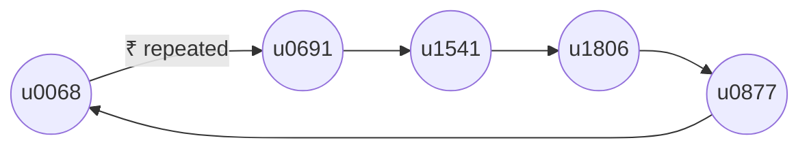

*Figure 7: Structure of a fraud ring (one of the rings found by the job, five accounts)*

**Mules.** A mule is an account that is paid **once each** by at least 20 different accounts and passes on between 50% and 150% of what it receives. The "once each" part matters: a popular shop is also paid by many people, but its regular customers pay it again and again, and it does not send the money on (Figure 8).

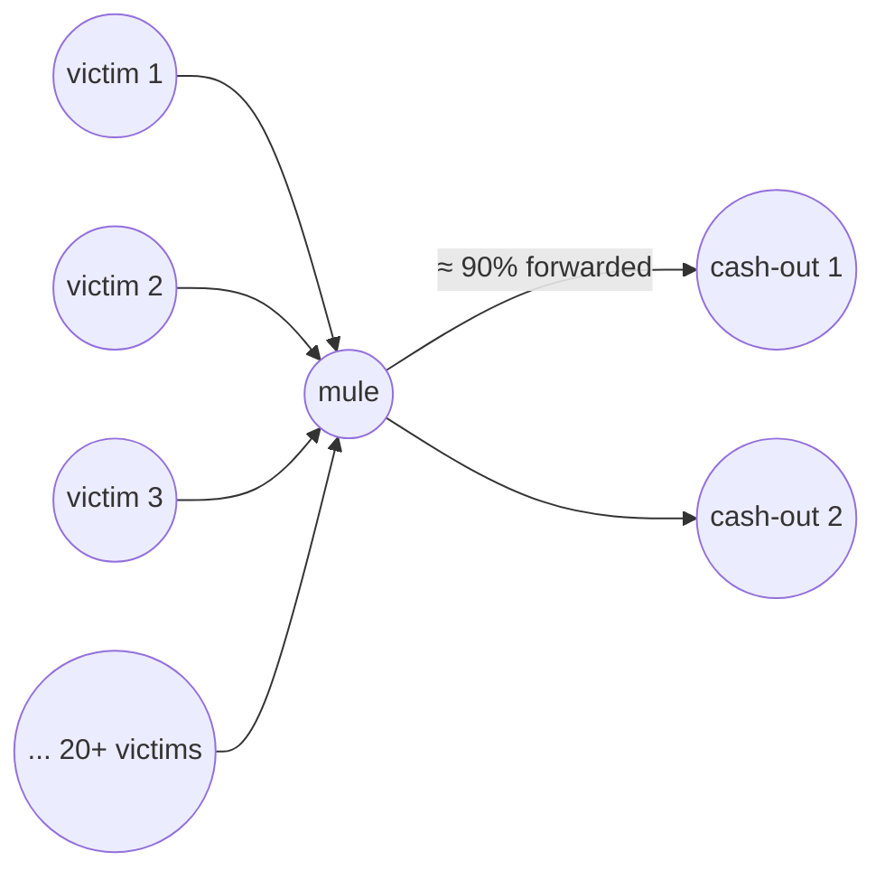

*Figure 8: Structure of a money mule*

The results replace the contents of the HBase `rings` table. New rows are written first and stale ones deleted afterwards, so the dashboard never sees an empty table halfway through an update. If a run finds nothing at all, the previous result is kept. The job finishes by printing precision and recall against the generator's labels.

Two thresholds deserve a comment. The 250,000-payment cap is a count rather than a time window. An earlier version used "the last 24 hours before the newest payment", and when the generator was paused and restarted, that window held almost nothing and the rings disappeared from the dashboard. The second is GraphFrames' `maxIter` for strongly connected components. At the default of 10, a test with a chain of 12 linked rings silently lost three of them; at 50, all were found.

### 5.6 Dashboard

The dashboard (`dashboard/app.py` and `dashboard/index.html`) is a single page served by FastAPI. It has no build step and no frontend framework; we wanted something that would still run in five years without an `npm install`.

**Table 7: Dashboard endpoints**

| Endpoint | Source | Returns |
|:---|:---|:---|
| `GET /` | file | The dashboard page |
| `GET /events` | Kafka `scored` | A stream of every scored payment, as server-sent events |
| `GET /api/alerts?limit=50` | HBase `alerts` | The newest flagged payments (limit between 1 and 500) |
| `GET /api/rings` | HBase `rings` | All detected clusters, largest amount first |

The page has three parts (Figure 9):

- **Live transactions:** every payment as it is scored, with risky rows highlighted. New rows arrive over server-sent events, a simple browser feature in which the server keeps one HTTP response open and writes a line for each new event.
- **Fraud alerts:** each alert lists the signals behind it, for example "17× usual amount, new payee" or "new device, 8× usual amount, new payee". These come straight from the stored features, so an analyst can see *why* a payment was flagged instead of trusting a bare number.
- **Fraud rings and mule accounts:** the clusters found by the graph job. Clicking one draws it as a graph using SVG. A ring is drawn as a cycle with arrows, and a mule as a star with its victims around it and its cash-out accounts highlighted.

The status indicator in the header turns from "Live" to "No new data" if nothing has arrived for 15 seconds. The server-sent event connection stays open even when the scorer has stopped, so without this check a broken pipeline would still look healthy.

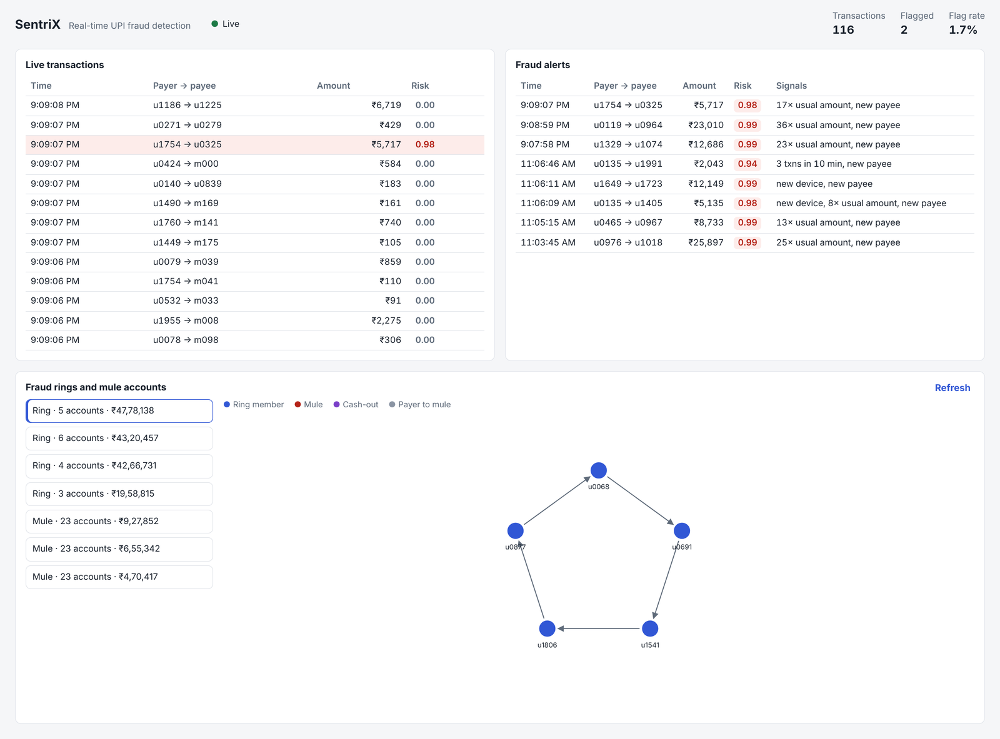

*Figure 9: The SentriX dashboard during a live run. Live feed (top left), alerts with their signals (top right), and the detected rings and mules with the selected five-account ring drawn (bottom).*

### 5.7 Infrastructure

**One image, many roles.** `infra/Dockerfile` builds a single image with Java, Hadoop, HBase, Spark, Kafka, GraphFrames and the Python libraries. When a container starts, `infra/entrypoint.sh` looks at the `ROLE` variable and starts the daemons for that role: the master's daemons in a set order (HDFS first, because HBase stores its data there), or a worker's DataNode, Spark worker and RegionServer once the master's ports answer. Every download is checked against a pinned SHA-512 or SHA-256 checksum, so a corrupted or tampered file fails the build instead of ending up in the cluster.

**Self-healing nodes.** After start-up, the entrypoint script becomes a watchdog. Every 10 seconds it checks that each of the node's daemons is still running, and if one is missing it exits. Docker's restart policy then restarts the whole container, which starts all the daemons again. In our tests a node recovered within 7 to 14 seconds of a daemon being killed.

**Code mounted, not copied.** The repository is mounted read-only at `/app` in every container. Changing a Spark job does not need a rebuild, and nothing inside a container can modify the code.

**Commands.** A `Makefile` wraps everything in short commands: `make up`, `make status`, `make history`, `make train`, `make stream`, `make live`, `make rings`, `make test`, plus `make lan-master` and `make lan-worker` for the three-PC setup (Appendix A).

<div style="page-break-after: always;"></div>

## 6. Testing

### 6.1 Automated Tests

There are twelve automated tests, written with pytest. Rather than aiming for line coverage, we wrote them for the parts where a silent mistake would give wrong results without crashing anything.

**Table 8: Automated tests**

| File | Test | What it protects |
|:---|:---|:---|
| `test_features.py` | first payment has no history | Features of a brand-new account |
| | window, ratio and known counterparties | The 10-minute window edge, the average, payee and device memory |
| | state survives a JSON round trip | Profiles stored in HBase give the same features as in memory |
| | known payees are capped, least recently used first | The 200-entry limit drops the stalest entries |
| `test_gen.py` | history is reproducible, ordered and sane | Same seed, same data; timestamps in order; positive amounts |
| | fraud patterns use the fixed actors | Rings and mules involve only the planted accounts |
| `test_dashboard.py` | alerts newest first, limit validated | The inverted key order; out-of-range limits are rejected |
| | rings sorted by score, missing tables created | Dashboard works on an empty HBase |
| `test_rings.py` | finds the ring and the mule but not the shop | Both rules, and no false positive on a busy merchant |
| | a pause in activity does not hide the ring | The count cap instead of a time window |
| | a replayed transaction counts once | De-duplication by `txn_id` |
| | save replaces the result but keeps it when nothing is found | Write order and the empty-result rule |

The ring tests run on a real local Spark session with GraphFrames rather than on mocks, because the behaviour we care about (for example the iteration limit) is inside GraphFrames itself. The dashboard tests replace HBase with a small in-memory fake.

The tests run automatically on GitHub Actions for every pull request, with the same Python, Java and library versions as the Docker image.

### 6.2 End-to-End Testing

Unit tests cannot show that five distributed systems work together, so before each major change we ran the whole pipeline on a fresh cluster:

1. `make up`, then `make status` until it reported 2 DataNodes, 2 Spark workers and 2 RegionServers.
2. `make history` and `make train`, checking the printed metrics.
3. `make stream` and `make live` in two terminals, measuring the delay between a payment's timestamp and its arrival on the `scored` topic.
4. `make rings` while the scorer was still running, checking precision and recall.
5. Checking the dashboard in its "Live" and "No new data" states.
6. Killing a daemon inside a worker and timing how long the node took to come back.
7. Sending a payment dated in the year 2100 and checking that it was dropped.
8. Retraining and checking that existing live profiles were not overwritten.

### 6.3 Three-PC Testing

To test the three-PC setup we ran three separate Docker engines on one host, each in its own container, connected only through a shared virtual LAN with their own IP addresses, and joined them into a swarm. This behaves like three PCs as far as Docker networking is concerned. With the master on the first engine and one worker on each of the others:

- `make status` reported 2 DataNodes, 2 Spark workers and 2 RegionServers, and Spark showed executors running on both remote workers.
- Training produced exactly the same metrics as on a single machine.
- Live alerts reached the dashboard, and the ring job again found all ring accounts and mules.
- Killing the DataNode on a worker restarted that worker, and it rejoined the cluster by itself.

We have not yet repeated this on three physical lab PCs at the time of writing.

<div style="page-break-after: always;"></div>

## 7. Results and Discussion

### 7.1 Model Performance

The model was evaluated on the last 20% of the simulated day: 35,765 payments, of which 942 were fraudulent (2.6%).

**Table 9: Model results on the held-out test set**

| Metric | Value | In plain words |
|:---|:---:|:---|
| Precision | 0.984 | 98.4% of the payments it flags really are fraud |
| Recall | 0.943 | It catches 94.3% of the fraud |
| AUC-PR | 0.992 | Area under the precision-recall curve; 1.0 is perfect |
| AUC-ROC | 1.000 | Fraud is almost always ranked above genuine payments |

**Table 10: Confusion matrix (threshold 0.5)**

| | Predicted fraud | Predicted genuine |
|:---|:---:|:---:|
| **Actually fraud** | 888 | 54 |
| **Actually genuine** | 14 | 34,809 |

Only 14 genuine payments out of almost 35,000 were flagged, which matters because every false alert is a real customer whose payment gets blocked. We did not inspect the 54 missed frauds one by one, but a breakdown by pattern shows where they come from: the model caught 95.5% of takeover payments, 97.7% of spikes and 96.4% of ring payments, but only 69.8% of payments to mules. Each victim pays a mule only once, so the velocity features give no signal, and mule payments are less extreme than spikes (median amount ratio 10.7 against 21.5). Those are the cases the graph job is for.

An AUC-ROC of 1.000 should be read with care. On data with 2.6% fraud, the ROC curve looks excellent as long as the model ranks most genuine payments low, even if it raises many false alarms near the top; the PR curve does not hide this [7], which is why we treat AUC-PR as the main number.

### 7.2 Streaming Performance

**Table 11: Streaming and system measurements**

| Measurement | Result |
|:---|:---|
| Time from payment to scored output, median | 4.1 s |
| Time from payment to scored output, 95th percentile | 6.4 s |
| Share of live payments flagged | 2.4% (fraud injected by the generator: about 2.7%) |
| Micro-batch interval | 2 s |
| Training job run time | about 55 s |
| Ring job run time | about 60 s |
| Fresh cluster start until all three nodes are ready | 46 s |
| Recovery after a daemon is killed | 7 to 14 s |
| Peak memory, scorer + live generator + ring job together | 8.4 GB |

The latency is dominated by the two-second trigger and the HBase round trip for the profiles. Half the payments wait a second or more just for the next batch to start. A shorter trigger would lower the median but increase the per-batch overhead, and for a fraud check that runs alongside a payment that settles in a few seconds, about four seconds is acceptable for a demonstration.

The live flag rate of 2.4% sitting just below the injected 2.7% is a useful sanity check. It is consistent with the recall measured offline, and it shows that the live scorer, which computes features from HBase profiles, behaves like the model did on replayed history. That is the practical result of sharing one feature function.

### 7.3 Graph Analysis

**Table 12: Graph analysis results**

| | Planted in the data | Found | Precision | Recall |
|:---|:---:|:---:|:---:|:---:|
| Ring accounts (4 rings of 3, 4, 5 and 6) | 18 | 18 | 1.00 | 1.00 |
| Mule accounts | 3 | 3 | 1.00 | 1.00 |

Seven clusters were written to HBase: the four rings, which together moved between ₹19.6 lakh and ₹47.8 lakh each, and the three mules, which received between ₹4.7 lakh and ₹9.3 lakh. None of the 2,000 ordinary users or 200 merchants was flagged, including busy merchants with hundreds of customers.

### 7.4 What the Detected Clusters Look Like

| Fraud ring | Money mule |
|:---:|:---:|
| 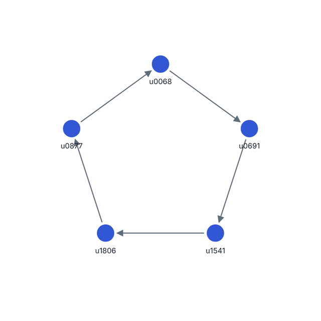 | 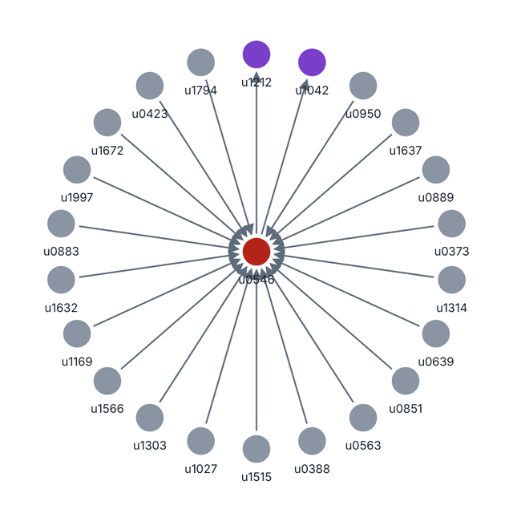 |
| Five accounts passing about ₹47.8 lakh around a cycle | Account u0546 (red), paid once each by 20 different accounts (grey), forwarding to two cash-out accounts (purple); ₹9.28 lakh received |

*Figure 10: A detected ring and a detected mule, as drawn by the dashboard*

The per-payment model catches most ring payments, because they are unusually large for the accounts involved, but it misses about 30% of the payments into mules: each victim pays only once, so nothing in the burst features stands out. The graph job sees the structure instead and finds every mule account. This is exactly the gap it was built to fill.

<div style="page-break-after: always;"></div>

## 8. Challenges Faced

Running five distributed systems together produced a number of problems that none of us expected from the documentation. Table 13 lists the main ones; a few are explained in more detail below.

**Table 13: Challenges and how we solved them**

| Challenge | What went wrong | How we solved it |
|:---|:---|:---|
| Train/serve skew | Features computed separately for training and live scoring could drift apart | One feature function `step()` used by both |
| HBase rejected the workers | The master looked up each RegionServer by reverse DNS, and Docker returned a different name from the one the worker reported | Configured the master to trust the hostname each RegionServer reports |
| Port 8080 conflict | ZooKeeper, started by HBase, opened an admin web server on 8080, the Spark master's port | Turned off ZooKeeper's admin server, which we did not use |
| Rings disappearing | The ring job used a 24-hour window ending at the newest payment; after a pause it found nothing and the dashboard went empty | Analyse the newest 250,000 payments, write before deleting, keep the old result if nothing is found |
| Tens of thousands of tiny files | Archiving each 2-second batch would create about 43,000 files a day on HDFS | Separate streaming query with the file sink, one file a minute, written exactly once |
| Crashed daemons went unnoticed | A RegionServer could die while its container kept running | Watchdog in every container restarts the node |
| Replayed messages | After a crash Kafka can deliver a batch again, which could fake a "repeated transfer" for the ring rule | Ring job removes duplicates by `txn_id` |
| Missed rings at default settings | GraphFrames' default iteration limit silently missed some linked rings | Raised `maxIter` from 10 to 50 and added a test |
| Multi-PC networking | Every config file uses the names `master`, `worker1`, `worker2`; real PCs have IP addresses | Docker Swarm overlay network, so the same names work across PCs |

**HBase and Docker DNS.** This one took the longest. The RegionServers would start and try to register with the HBase master, but the master refused them, and the cause was not obvious from the logs. It turned out to be that the master does a reverse DNS lookup on each RegionServer's IP address, and Docker's DNS answers with the container's full name (for example `sentrix-worker1-1`) instead of the hostname the RegionServer reports (`worker1`). Since the two names did not match, the master rejected it. The setting `hbase.regionserver.hostname.disable.master.reversedns=true` makes the master use the reported name instead. HDFS had a similar check, which we turned off with `dfs.namenode.datanode.registration.ip-hostname-check=false`.

**Disappearing rings.** We found this in a review of our own code, not in a test. The ring job's window was "24 hours before the newest payment in the archive". That works while the generator runs continuously, but if it is stopped for a day and restarted, the newest payments are only minutes old, the window holds only those, the job finds no rings, and the table is wiped. We now cap the input by count, write the new results before removing old ones, and keep the old result if a run finds nothing. A test now covers the pause.

**Spark's lazy evaluation.** Each micro-batch's featurised data is used twice, once to write alerts and once to write to Kafka. Spark only computes a DataFrame when an action needs it, so without care it would run the feature step for each use, and every profile in HBase would be updated twice per batch, doubling counts such as `cnt_10m`. Calling `localCheckpoint()` makes Spark compute the result once and reuse it.

<div style="page-break-after: always;"></div>

## 9. Limitations and Future Work

### 9.1 Limitations

1. **Synthetic data.** This is the biggest limitation. The generator plants fraud with clear signals, so a well-built model finds it easily. Real fraudsters adapt, labels arrive weeks later through complaints and chargebacks, and genuine customers behave in far more varied ways. We would expect real precision and recall to be noticeably lower.
2. **Thresholds tuned to the generator.** The ring rule (₹50,000 and two transfers), the mule rule (20 payers, 50 to 150% pass-through) and the 0.5 alert threshold were chosen with the synthetic data in mind.
3. **At-least-once profile updates.** If the streaming driver crashes in the middle of a batch, Spark replays it after the restart, and the affected profiles are updated twice. Alerts and archive writes are safe, and the ring job removes duplicates, but a profile can briefly show slightly higher counts. We documented this as a known shortcut.
4. **Single master.** The master node is a single point of failure for HDFS, HBase, Spark and Kafka. Production clusters run standby NameNodes, backup HBase masters and several Kafka brokers.
5. **Scale tested only at demo level.** The live rate is two payments per second. The design is distributed throughout, but we have not measured how it behaves at thousands of payments per second.

### 9.2 Future Work

- Evaluate the model on a public fraud dataset to get a more realistic idea of its accuracy.
- Run the cluster on three physical lab PCs and compare latency with the single-machine numbers.
- Retrain on a schedule and monitor the score distribution for *drift*, the gradual change in behaviour that makes a model less accurate over time.
- Make profile updates exactly-once, for example by storing the Kafka offset of the last applied payment with each profile.
- Detect more patterns in the graph, such as chains of mules (layering) and accounts that are close to known fraud accounts.
- Show per-feature contributions to each score in the dashboard, so that alerts are easier to explain.

<div style="page-break-after: always;"></div>

## 10. Conclusion

We set out to build a system that detects UPI fraud both at the level of single payments and at the level of groups of accounts, on a real distributed cluster. SentriX does this with Kafka for the streams, Spark Structured Streaming and MLlib for scoring and training, HBase for fast per-account lookups, HDFS for bulk data and GraphFrames for the payment graph, on one master and two workers that can run on one machine or on three PCs.

On our synthetic data the system scores each payment about four seconds after it is made, 98% of its alerts are real fraud, and it catches 94% of the fraud. The graph job finds every planted ring and mule account without flagging a single innocent one. Just as important to us was that the system is understandable: every alert says why it fired, and every detected ring can be drawn and inspected.

The most useful lessons were not about any one tool. Computing features in one place for both training and serving removed a whole class of bugs. Choosing where data lives by how it is used (by key, in bulk or in motion) made each part simpler. And most of our time went into getting the five systems to agree on names, ports and timing, which is a large part of real big data work.

<div style="page-break-after: always;"></div>

## References

[1] Entrackr, "UPI hits all-time high of 20.7 bn transactions in October," Nov. 2025. https://entrackr.com/news/upi-hits-all-time-high-of-207-bn-transactions-in-october-10612233

[2] Business Today, "UPI hits record 754 mn transactions in a single day; monthly volume surges to 20.7 bn in October," Nov. 2025. https://www.businesstoday.in/personal-finance/banking/story/upi-hits-record-754-mn-transactions-in-a-single-day-monthly-volume-surges-to-207-bn-in-october-500469-2025-11-01

[3] YourStory, "UPI frauds peak in FY24, show signs of decline: Parliament data," Dec. 2025. https://yourstory.com/2025/12/upi-frauds-peak-in-fy24-show-signs-of-decline-parliament-data

[4] IANS, "UPI frauds worth Rs 805 crore witnessed this fiscal so far: Minister," Dec. 2025. https://ianslive.in/upi-frauds-worth-rs-805-crore-witnessed-this-fiscal-so-far-minister--20251215175703

[5] Free Press Journal, "India reports ₹805 crore UPI fraud till Nov FY26 amid rising digital payments," Dec. 2025. https://www.freepressjournal.in/tech/india-reports-805-crore-upi-fraud-till-nov-fy26-amid-rising-digital-payments

[6] R. J. Bolton and D. J. Hand, "Statistical fraud detection: A review," *Statistical Science*, vol. 17, no. 3, pp. 235–255, 2002.

[7] T. Saito and M. Rehmsmeier, "The precision-recall plot is more informative than the ROC plot when evaluating binary classifiers on imbalanced datasets," *PLoS ONE*, vol. 10, no. 3, e0118432, 2015.

[8] L. Breiman, "Random forests," *Machine Learning*, vol. 45, no. 1, pp. 5–32, 2001.

[9] R. Tarjan, "Depth-first search and linear graph algorithms," *SIAM Journal on Computing*, vol. 1, no. 2, pp. 146–160, 1972.

[10] K. Shvachko, H. Kuang, S. Radia and R. Chansler, "The Hadoop Distributed File System," in *Proc. IEEE 26th Symposium on Mass Storage Systems and Technologies (MSST)*, 2010.

[11] F. Chang et al., "Bigtable: A distributed storage system for structured data," in *Proc. 7th USENIX Symposium on Operating Systems Design and Implementation (OSDI)*, 2006.

[12] J. Kreps, N. Narkhede and J. Rao, "Kafka: A distributed messaging system for log processing," in *Proc. NetDB Workshop*, 2011.

[13] M. Zaharia et al., "Resilient distributed datasets: A fault-tolerant abstraction for in-memory cluster computing," in *Proc. 9th USENIX Symposium on Networked Systems Design and Implementation (NSDI)*, 2012.

[14] M. Armbrust et al., "Structured Streaming: A declarative API for real-time applications in Apache Spark," in *Proc. ACM SIGMOD International Conference on Management of Data*, 2018.

[15] A. Dave, A. Jindal, L. E. Li, R. Xin, J. Gonzalez and M. Zaharia, "GraphFrames: An integrated API for mixing graph and relational queries," in *Proc. Fourth International Workshop on Graph Data Management Experiences and Systems (GRADES)*, 2016.

[16] Apache Software Foundation, documentation for Apache Hadoop 3.3, HBase 2.6, Spark 3.5 and Kafka 3.9. https://hadoop.apache.org, https://hbase.apache.org, https://spark.apache.org, https://kafka.apache.org

<div style="page-break-after: always;"></div>

## Appendix A: Running the Project

### A.1 On one machine

```bash
make up        # build the image and start master, worker1, worker2 and the dashboard
make status    # expect 2 DataNodes, 2 Spark workers, 2 RegionServers
make history   # 24 hours of labelled payments into HDFS
make train     # train the model and seed account profiles in HBase
make stream    # terminal 1: real-time scorer (keeps running)
make live      # terminal 2: live payments into Kafka (keeps running)
make rings     # fraud-ring and mule detection, any time
```

The dashboard is at http://localhost:8000. The HDFS, Spark and HBase web interfaces are at ports 9870, 8080 and 16010. `make test` runs the automated tests, `make down` stops the cluster, and `make clean` also deletes all data.

### A.2 On three PCs

On the master PC (replace `MASTER_IP` with its LAN address):

```bash
docker swarm init --advertise-addr MASTER_IP
docker network create -d overlay --attachable sentrix-net
```

Run the `docker swarm join ...` command printed by the first step on both worker PCs. Then start the nodes, in any order:

```bash
make lan-worker N=1   # on the first worker PC
make lan-worker N=2   # on the second worker PC
make lan-master       # on the master PC
```

All other commands (`make status`, `make history`, `make train`, `make stream`, `make live`, `make rings`) are run on the master PC as in A.1.

## Appendix B: Repository Layout

```
SentriX/
├── docker-compose.yml        cluster on one machine
├── docker-compose.lan.yml    network override for three PCs
├── Makefile                  short commands for every step
├── infra/
│   ├── Dockerfile            one image for every node
│   ├── entrypoint.sh         starts the daemons for each role, plus the watchdog
│   └── conf/                 Hadoop, HBase, Spark and Kafka configuration
├── sentrix/
│   ├── gen.py                synthetic payment generator
│   ├── features.py           the shared feature function
│   └── store.py              HBase tables and the alert row key
├── jobs/
│   ├── train.py              model training
│   ├── stream.py             real-time scorer and archive
│   └── rings.py              GraphFrames ring and mule detection
├── dashboard/
│   ├── app.py                FastAPI backend
│   └── index.html            the dashboard page
└── tests/                    12 automated tests
```

## Appendix C: Selected Configuration

**Spark (`infra/conf/spark-defaults.conf`)**

```properties
spark.master                  spark://master:7077
spark.driver.memory           1g
spark.executor.memory         1g
# half the cluster per app, so the ring job can run next to the streaming scorer
spark.cores.max               2
spark.sql.shuffle.partitions  4
spark.executorEnv.PYTHONPATH  /app
```

**HDFS (`infra/conf/hdfs-site.xml`, main settings)**

```xml
<property><name>dfs.replication</name><value>2</value></property>
<property><name>dfs.namenode.datanode.registration.ip-hostname-check</name><value>false</value></property>
```

**HBase (`infra/conf/hbase-site.xml`, main settings)**

```xml
<property><name>hbase.rootdir</name><value>hdfs://master:9000/hbase</value></property>
<property><name>hbase.zookeeper.quorum</name><value>master</value></property>
<property><name>hbase.zookeeper.property.admin.enableServer</name><value>false</value></property>
<property><name>hbase.regionserver.hostname.disable.master.reversedns</name><value>true</value></property>
```

**Alert row key (`sentrix/store.py`)**

```python
def alert_key(ts, txn_id):
    return f"{10**13 - ts:013d}#{txn_id}"   # newest alerts sort first
```

**Three-PC network override (`docker-compose.lan.yml`)**

```yaml
networks:
  default:
    name: sentrix-net
    external: true
```
